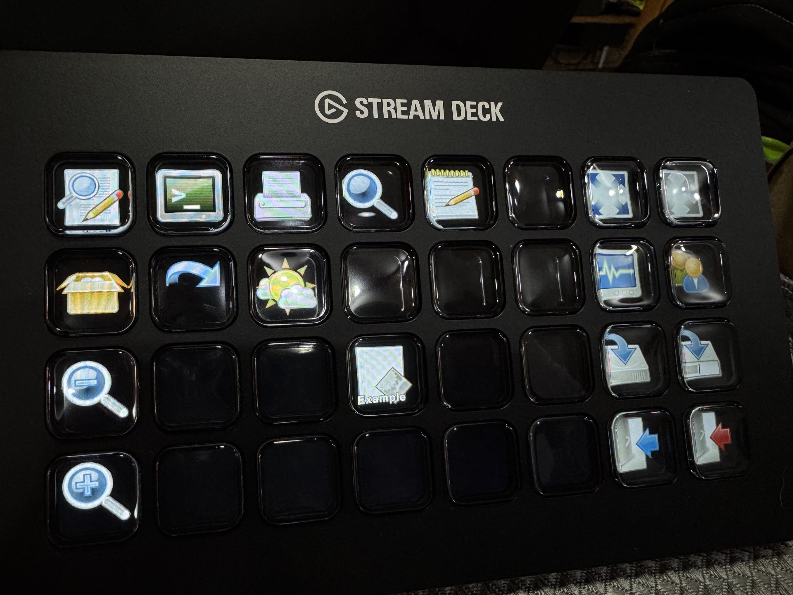

# Cuis for Stream Deck



## What does it do?

This plugin lets you control [Cuis Smalltalk](https://cuis.st) from your Stream Deck.

## How do I install it?

It isn't on the Elgato Marketplace yet, so for now it's installed from this repository. It has two parts: a Cuis package that runs the code the keys send, and a Stream Deck plugin with the keys.

### In Cuis

1. Clone [Cuis](https://github.com/Cuis-Smalltalk/Cuis-Smalltalk-Dev), [OSProcess](https://github.com/Cuis-Smalltalk/OSProcess) and this repository side by side. If you already have Cuis, clone the other two in the folder that contains your `Cuis-Smalltalk-Dev` folder:

   ```bash
   git clone --depth 1 https://github.com/Cuis-Smalltalk/Cuis-Smalltalk-Dev.git
   git clone https://github.com/Cuis-Smalltalk/OSProcess.git
   git clone https://github.com/wenoa/cuis-streamdeck.git
   ```

   OSProcess is the only package the StreamDeck package requires that doesn't come with Cuis. The others (WebClient, JSON, Identities-UUID and the ones they require) are already in `Cuis-Smalltalk-Dev`.

2. In a Workspace, evaluate:

   ```smalltalk
   Feature require: 'StreamDeck'
   ```

### In Stream Deck

1. Build the plugin:

   ```bash
   cd StreamDeck
   npm ci
   npm run build
   npm run pack
   ```

2. Double-click `StreamDeck/studio.wenoa.cuis.streamDeckPlugin`. Stream Deck will install the plugin.

### How do they find each other?

The package and the plugin share `~/.cuisdeck.json`, which holds the port the package listens on, on `127.0.0.1`, and the token the plugin sends with every key press.

It doesn't matter which one you install first: whichever starts first creates the file if it doesn't exist, with the port 2847 and a random token, readable only by your user. The other one reads it when it starts.

To change the port, edit the file and restart both.

## How do I work on it?

The Cuis package is `Cuis/StreamDeck.pck.st`. Load it as above and save it from Installed Packages.

For the Stream Deck plugin, link it to Stream Deck in developer mode and leave it rebuilding on every change:

```bash
cd StreamDeck
npm ci
npx streamdeck dev
npm run build
npx streamdeck link studio.wenoa.cuis.sdPlugin
npm run watch
```

Run its tests with `npm test`.

## Found a problem?

Open an issue or, better yet, send a pull request.

## Credits

Most action icons come from the [Tango](https://commons.wikimedia.org/wiki/Tango_icons) pack.

The Increase GUI Size and Decrease GUI Size icons are modified versions of [View-zoom-in.svg](https://commons.wikimedia.org/wiki/File:View-zoom-in.svg) and [View-zoom-out.svg](https://commons.wikimedia.org/wiki/File:View-zoom-out.svg) from Wikimedia Commons, by Mapto, Inductiveload and Smasongarrison, licensed under [CC BY-SA 3.0](https://creativecommons.org/licenses/by-sa/3.0/). The white floor highlight under the lens was removed and the size set to 144px. Both modified icons are distributed under the same license.
